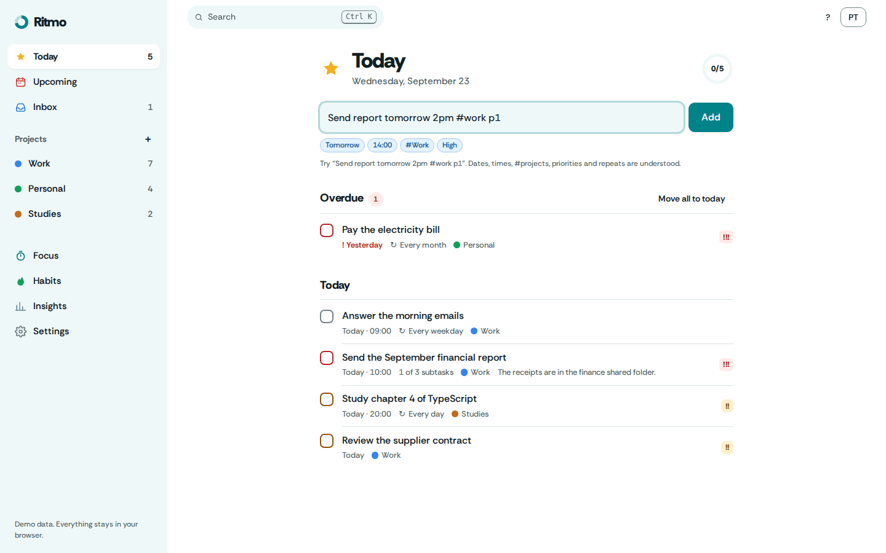
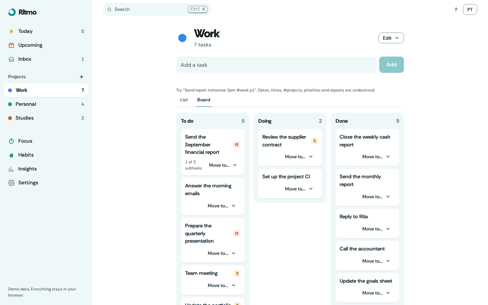
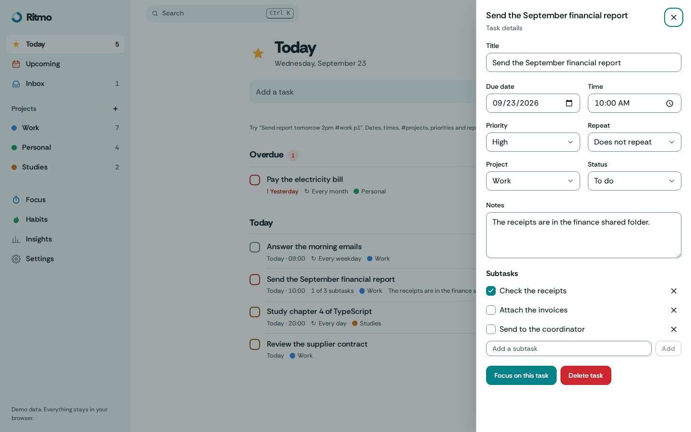
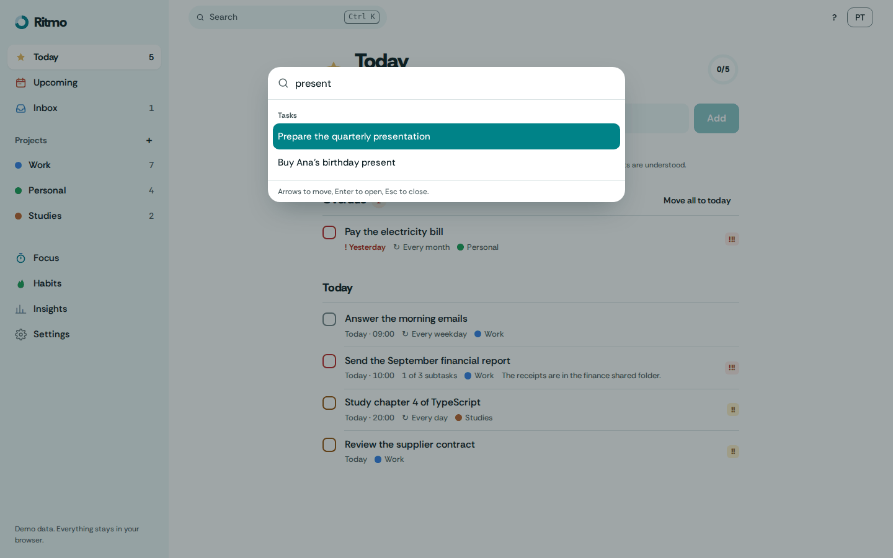
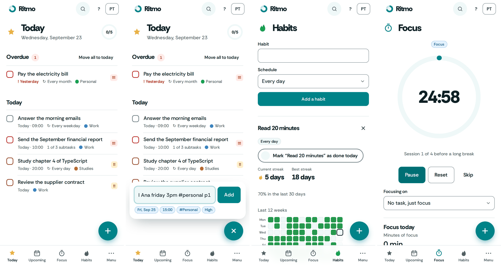
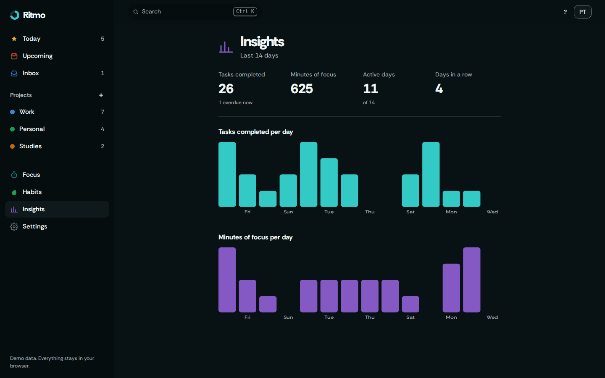

# Ritmo

Tasks, focus and habits in one calm, keyboard-first app. Type a task the way you think it, and Ritmo understands the date, the time, the project, the priority and the repeat. Built with React 19 and TypeScript on [Prumo](https://github.com/KaykeSiquara/prumo), my design system, and available in English and Portuguese.

[Leia em português](README.pt-BR.md) · [Live demo](https://kayke-siquara-ritmo.vercel.app)



## What is in it

- **Quick add in plain language.** “Send report tomorrow 2pm #work p1” becomes a task for tomorrow at 14:00, in Work, with high priority. The same works in Portuguese: “Enviar relatório amanhã 14h #trabalho !alta”. What was understood shows as chips before you press Enter.
- **Today, Upcoming and Inbox.** Overdue tasks come first and can all move to today at once; the next seven days are grouped by day; tasks without a project land in the inbox.
- **Projects as a list or a board.** Cards can be dragged between To do, Doing and Done, or moved from a menu on each card, which works with a keyboard and a screen reader.
- **Tasks with everything a task needs.** Notes, due date and time, priority, subtasks and repeats (daily, weekdays, weekly, monthly). Completing a repeating task records the completion and moves it to the next date.
- **Undo.** Completing, deleting and moving can be undone from the confirmation.
- **Focus timer.** Pomodoro cycles tied to a task, a long break every four sessions, the time left in the tab title, and sessions recorded per day.
- **Habits.** Daily or weekday habits, the current and best streak, the rate over 30 days, and a 12-week map you can fill in from the keyboard.
- **Insights.** Tasks completed and minutes of focus per day over two weeks.
- **Keyboard first.** `N` adds a task, `Ctrl K` or `/` opens the command palette, `G` then `T`, `U`, `I`, `F` or `H` jumps to a view, arrows move through a list, `X` completes and `E` opens. `?` lists them all.
- **Settings and data.** Language, theme, density, the first day of the week and the timer lengths. Export and import everything as JSON, or restore the demo data.

| Board | Task details | Command palette |
| --- | --- | --- |
|  |  |  |



| Insights in the dark theme |
| --- |
|  |

## Decisions worth reading

**The parser is a pure function, with its hard cases tested.** `src/domain/parser.ts` reads both languages without a library. It folds accents while keeping character positions, so it can remove what it understood from the title and leave the rest exactly as typed. The tests cover the traps:
- “amanhecer” is not “amanhã”, and “25h” is not a time;
- a date that already passed this year, such as “10/09”, goes to next year;
- “toda segunda” means weekly, starting next Monday.

**The timer counts from the clock, not from ticks.** It stores when the phase ends, not how many seconds are left, so a busy tab or a throttled interval never makes it drift. The state is saved, so a reload continues the session, and a session that ended while the app was closed is recorded when you come back.

**Repeating tasks keep their history.** Completing one creates a completed record for today and moves the original to the next date. A task that was overdue is never rescheduled into the past.

**Drag and drop is not the only way.** Every card has a “Move to…” menu, and every move is announced in the live region with an undo. The 12-week habit map is a grid with a single tab stop: arrows move between days, so 84 cells are not 84 stops for the Tab key.

**The state has no library.** A small store built on `useSyncExternalStore` holds the state, with a pure reducer that is tested directly, a one-step undo and debounced saving to `localStorage`. Selectors are cached, so a selector that returns a new object does not re-render in a loop. Imports are validated, and a corrupt save falls back to the demo data instead of a blank screen.

**Built on Prumo, dressed as Ritmo.** Every control, dialog, menu, tab, toast and badge comes from [Prumo](https://github.com/KaykeSiquara/prumo), with its seven states and its accessibility contract. The identity is Ritmo's own: `src/theme.css` overrides Prumo's tokens with a teal accent, the Rethink Sans typeface, rounder shapes and 44 px touch targets on touch screens. Swapping a design system's look without touching a component is the point of having one. Until Prumo is on npm, the package is included as `vendor/kaykesiquara-prumo-0.1.0.tgz`; when it is published, replace that line in `package.json` with a version number.

## Design

The direction is written down before the code, in [`PRODUCT.md`](PRODUCT.md) and [`DESIGN.md`](DESIGN.md): energetic, motivating and alive, used on a phone throughout the day, with Things 3 as the reference for feel.

- **Phone first.** A tab bar at the bottom and a floating add button that opens the quick add next to the thumb. On wider screens, a sidebar and a narrow central column.
- **Every list has an identity.** Today has a yellow star, Upcoming a red calendar, Habits a green flame, each project its own color, so a list is found at a glance.
- **Momentum is visible.** A ring shows how much of today is done, the checkbox fills and pops when a task is completed, and the habit button fills when the day is marked.
- **Color is committed to one role.** Teal carries every action, selection and progress; sun yellow only appears in icons; red is kept for overdue work.
- **Contrast is tested.** `src/theme.test.ts` reads the tokens from `theme.css` and checks 32 pairs in each theme against WCAG 2.1.

## Run it

```bash
npm install
npm run dev     # http://localhost:5173
npm test
npm run build   # static files in dist/
```

The first visit loads demo data in the browser's language. Everything stays in your browser.

## Tests

170 tests with Vitest and Testing Library:

- domain: 57, for dates, the quick add parser in both languages, repeats, habit streaks and the timer;
- state: 17, for the reducer, undo, saving and loading, import validation, the selectors and translating the demo data;
- theme: 64, the contrast of every documented pair in both themes;
- interface: 32, covering quick add, completing and undoing, keyboard navigation, the task sheet, moving cards, the timer, habits, the command palette, the shortcuts, the language switch and imports, plus axe on every view in both languages.

Switching the language also translates the demo tasks, projects and habits, but never anything you wrote or edited.

CI runs the type check, the tests and the build on Node 20 and 22.

## Structure

```
src/domain/      dates, the quick add parser, repeats, habits and the timer, all pure
src/store/       state, reducer, selectors, demo data and the store
src/app/         providers, layout, routes and the timer runner
src/components/  task row and list, quick add, task sheet, command palette
src/views/       Today, Upcoming, Inbox, Project, Focus, Habits, Insights, Settings
src/i18n/        English and Portuguese
src/theme.css    Ritmo's identity, as overrides of Prumo's tokens
vendor/          the Prumo package
```

## License

MIT
