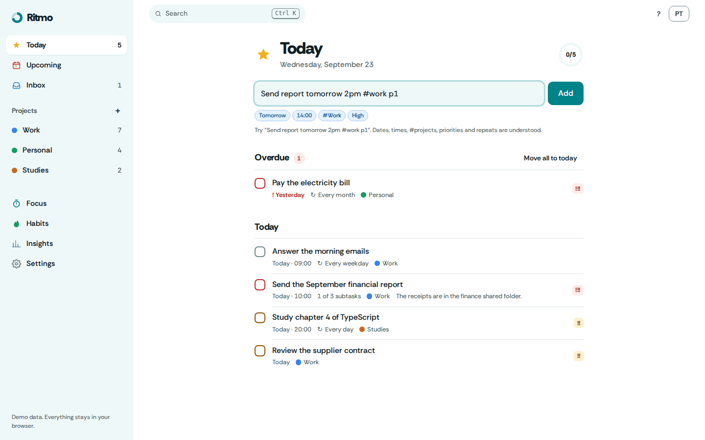
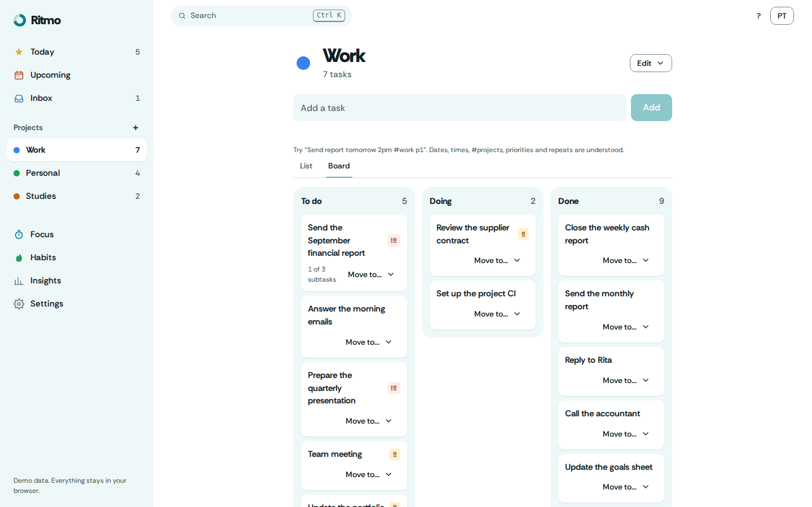
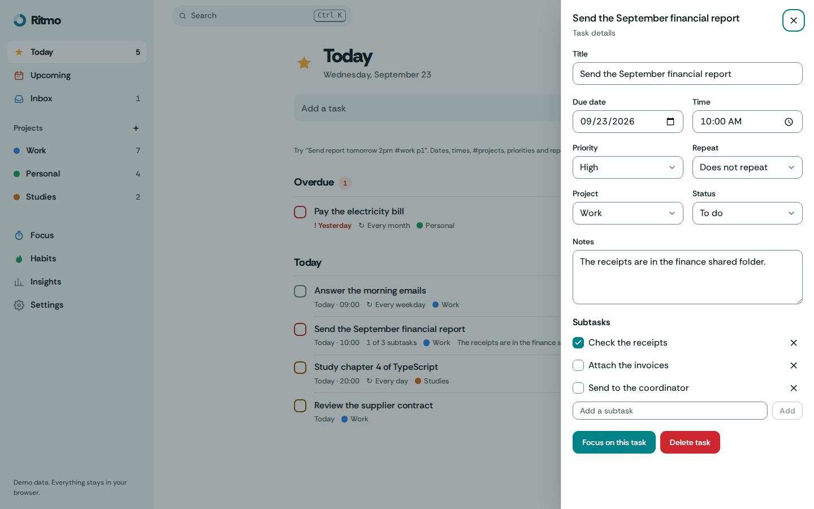
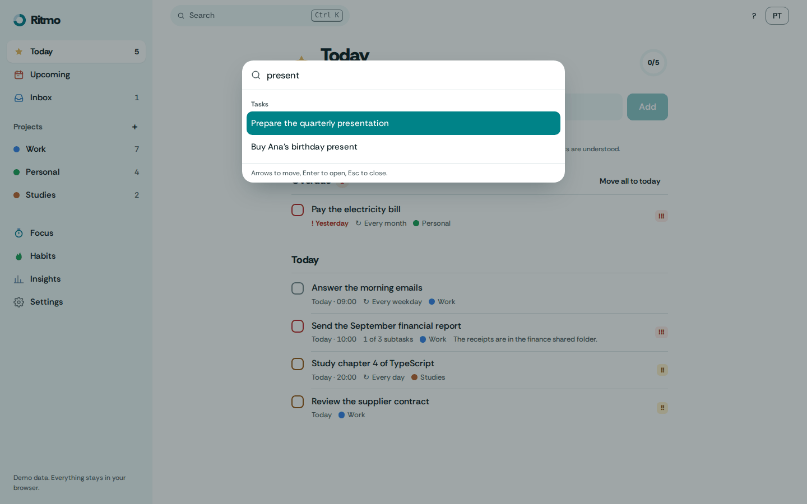
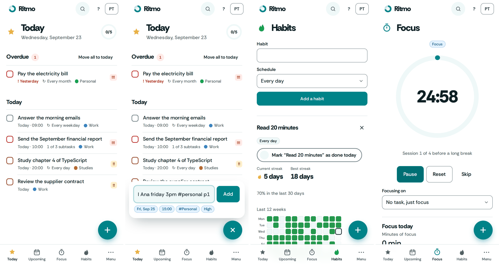
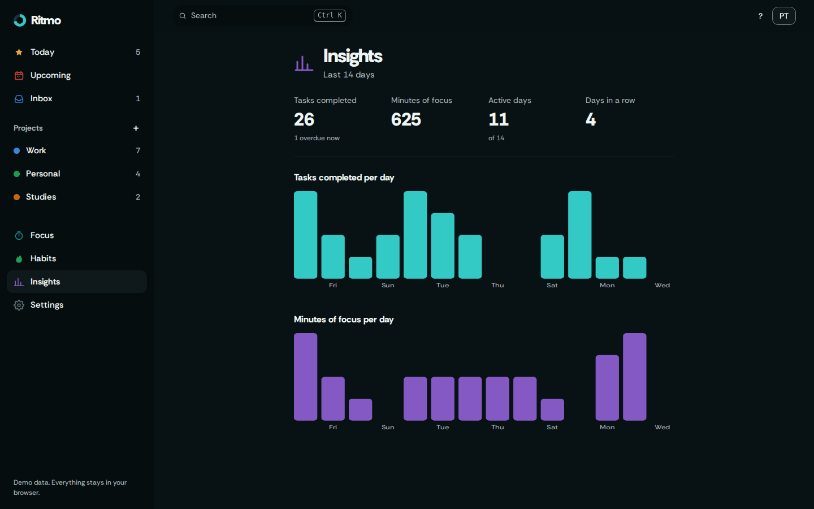

# Ritmo

Tarefas, foco e hábitos num app calmo, feito para o teclado. Escreva a tarefa do jeito que você pensa, e o Ritmo entende a data, o horário, o projeto, a prioridade e a repetição. Feito com React 19 e TypeScript sobre o [Prumo](https://github.com/KaykeSiquara/prumo), o meu design system, em português e inglês.

[Read in English](README.md) · [Demonstração](https://kayke-siquara-ritmo.vercel.app)



## O que tem

- **Adição rápida em linguagem natural.** “Enviar relatório amanhã 14h #trabalho !alta” vira uma tarefa para amanhã às 14:00, no projeto Trabalho, com prioridade alta. Em inglês também funciona: “Send report tomorrow 2pm #work p1”. O que foi entendido aparece em selos antes de você apertar Enter.
- **Hoje, Próximos dias e Caixa de entrada.** As atrasadas vêm primeiro e podem ir todas para hoje de uma vez; os próximos sete dias ficam agrupados por dia; tarefas sem projeto caem na caixa de entrada.
- **Projetos em lista ou quadro.** Os cartões podem ser arrastados entre A fazer, Fazendo e Feito, ou movidos por um menu em cada cartão, que funciona com teclado e leitor de tela.
- **Tarefas com tudo o que uma tarefa precisa.** Notas, data e horário, prioridade, subtarefas e repetição (diária, dias úteis, semanal, mensal). Concluir uma tarefa repetida registra a conclusão e a leva para a próxima data.
- **Desfazer.** Concluir, excluir e mover podem ser desfeitos pela própria confirmação.
- **Cronômetro de foco.** Ciclos Pomodoro ligados a uma tarefa, pausa longa a cada quatro sessões, o tempo restante no título da aba e as sessões registradas por dia.
- **Hábitos.** Hábitos diários ou de dias úteis, a sequência atual e a melhor, a taxa em 30 dias e um mapa de 12 semanas que dá para preencher pelo teclado.
- **Resumo.** Tarefas concluídas e minutos de foco por dia, em duas semanas.
- **Feito para o teclado.** `N` adiciona tarefa, `Ctrl K` ou `/` abre a paleta de comandos, `G` seguido de `T`, `U`, `I`, `F` ou `H` leva a uma visão, as setas percorrem a lista, `X` conclui e `E` abre. `?` mostra todos.
- **Configurações e dados.** Idioma, tema, densidade, primeiro dia da semana e a duração do cronômetro. Exporte e importe tudo em JSON, ou restaure os dados de exemplo.

| Quadro | Detalhes da tarefa | Paleta de comandos |
| --- | --- | --- |
|  |  |  |



| Resumo no tema escuro |
| --- |
|  |

## Decisões que valem a leitura

**O leitor da adição rápida é uma função pura, com os casos difíceis testados.** O `src/domain/parser.ts` lê os dois idiomas sem biblioteca. Ele ignora acentos mantendo a posição de cada letra, então consegue tirar do título o que entendeu e deixar o resto exatamente como foi digitado. Os testes cobrem as armadilhas:
- “amanhecer” não é “amanhã”, e “25h” não é horário;
- uma data que já passou neste ano, como “10/09”, vai para o ano seguinte;
- “toda segunda” significa semanal, começando na próxima segunda.

**O cronômetro conta pelo relógio, não por intervalos.** Ele guarda quando a fase termina, e não quantos segundos faltam, então uma aba ocupada ou um intervalo atrasado nunca o fazem atrasar. O estado fica salvo: recarregar a página continua a sessão, e uma sessão que terminou com o app fechado é registrada quando você volta.

**Tarefas repetidas guardam o histórico.** Concluir uma cria um registro concluído no dia e leva a original para a próxima data. Uma tarefa atrasada nunca é reagendada para o passado.

**Arrastar e soltar não é o único caminho.** Todo cartão tem um menu “Mover para…”, e cada movimento é anunciado na região viva, com desfazer. O mapa de 12 semanas dos hábitos é uma grade com uma única parada de Tab: as setas andam entre os dias, então 84 células não viram 84 paradas de teclado.

**O estado não usa biblioteca.** Uma pequena store sobre o `useSyncExternalStore` guarda o estado, com um reducer puro testado diretamente, desfazer de um passo e gravação no `localStorage` com atraso curto. Os seletores são guardados em cache, para que um seletor que devolve objeto novo não faça a tela renderizar em loop. As importações são validadas, e um arquivo salvo corrompido volta para os dados de exemplo em vez de uma tela em branco.

**Construído sobre o Prumo, vestido de Ritmo.** Todo controle, diálogo, menu, aba, aviso e selo vem do [Prumo](https://github.com/KaykeSiquara/prumo), com os sete estados e o contrato de acessibilidade dele. A identidade é do Ritmo: o `src/theme.css` sobrescreve os tokens do Prumo com o azul-petróleo, a fonte Rethink Sans, formas mais arredondadas e alvos de toque de 44 px em telas de toque. Trocar a cara de um design system sem mexer em nenhum componente é justamente o motivo de ter um. Enquanto o Prumo não estiver no npm, o pacote vem incluído em `vendor/kaykesiquara-prumo-0.1.0.tgz`; quando ele for publicado, troque essa linha do `package.json` por um número de versão.

## Design

A direção foi escrita antes do código, no [`PRODUCT.md`](PRODUCT.md) e no [`DESIGN.md`](DESIGN.md): enérgico, motivador e vivo, usado no celular ao longo do dia, com o Things 3 como referência de sensação.

- **Celular primeiro.** Barra de abas embaixo e um botão flutuante que abre a adição rápida junto ao polegar. Em telas maiores, barra lateral e uma coluna central estreita.
- **Cada lista tem identidade.** Hoje tem a estrela amarela, Próximos dias o calendário vermelho, Hábitos a chama verde, cada projeto a sua cor, então uma lista é encontrada num relance.
- **O progresso aparece.** Um anel mostra quanto do dia já foi feito, a caixa enche e pulsa ao concluir uma tarefa, e o botão do hábito se enche quando o dia é marcado.
- **A cor tem um só papel.** O azul-petróleo carrega toda ação, seleção e progresso; o amarelo-sol só aparece em ícones; o vermelho fica para o que está atrasado.
- **O contraste é testado.** O `src/theme.test.ts` lê os tokens do `theme.css` e confere 32 pares em cada tema contra a WCAG 2.1.

## Como rodar

```bash
npm install
npm run dev     # http://localhost:5173
npm test
npm run build   # arquivos estáticos em dist/
```

Na primeira visita, os dados de exemplo aparecem no idioma do navegador. Tudo fica no seu navegador.

## Testes

170 testes com Vitest e Testing Library:

- domínio: 57, para datas, o leitor da adição rápida nos dois idiomas, repetição, sequências de hábitos e o cronômetro;
- estado: 17, para o reducer, o desfazer, a gravação e leitura, a validação da importação, os seletores e a tradução dos dados de exemplo;
- tema: 64, o contraste de cada par documentado nos dois temas;
- interface: 32, cobrindo adição rápida, concluir e desfazer, navegação pelo teclado, o painel da tarefa, mover cartões, o cronômetro, hábitos, a paleta de comandos, os atalhos, a troca de idioma e a importação, além do axe em todas as telas nos dois idiomas.

Trocar o idioma também traduz as tarefas, os projetos e os hábitos de exemplo, mas nunca o que você escreveu ou editou.

O CI roda a checagem de tipos, os testes e o build em Node 20 e 22.

## Estrutura

```
src/domain/      datas, o leitor da adição rápida, repetição, hábitos e cronômetro, tudo puro
src/store/       estado, reducer, seletores, dados de exemplo e a store
src/app/         provedores, layout, rotas e o cronômetro em segundo plano
src/components/  linha e lista de tarefas, adição rápida, painel da tarefa, paleta de comandos
src/views/       Hoje, Próximos dias, Caixa de entrada, Projeto, Foco, Hábitos, Resumo, Configurações
src/i18n/        português e inglês
src/theme.css    a identidade do Ritmo, como sobrescrita dos tokens do Prumo
vendor/          o pacote do Prumo
```

## Licença

MIT
